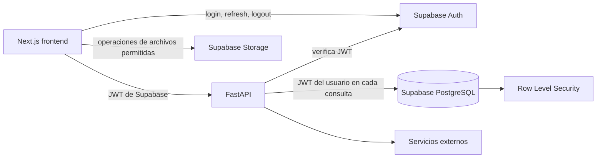
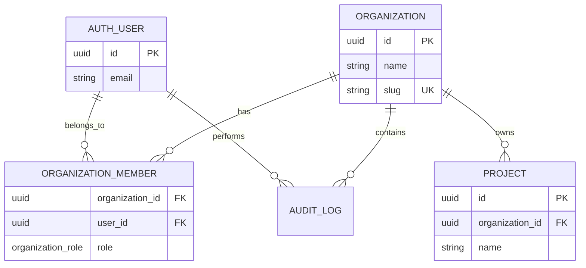
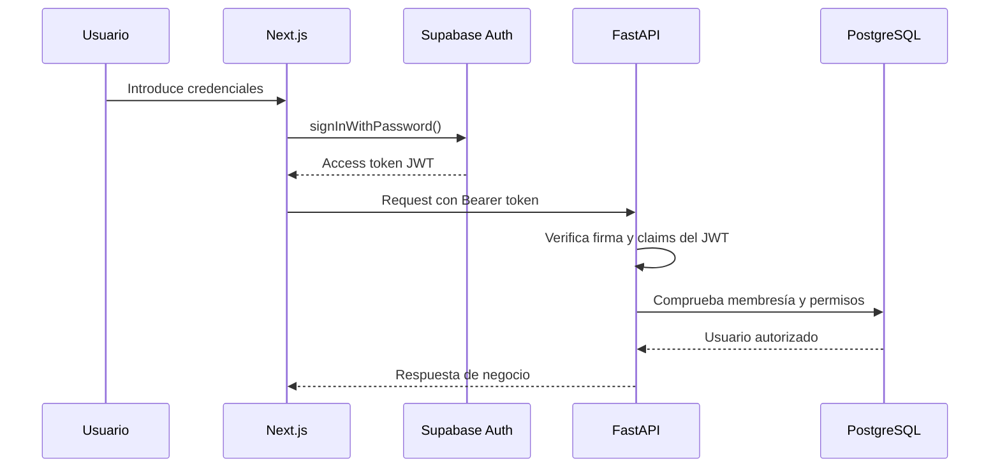

# Arquitectura SaaS Multi-Tenant

## Objetivo

Este repositorio sirve como base para aplicaciones SaaS con registro de usuarios,
autenticación, organizaciones, permisos, base de datos y módulos de negocio.

La arquitectura prioriza:

- Desarrollo rápido sin ocultar las decisiones importantes.
- Aislamiento de datos entre organizaciones.
- Un backend Python explícito para la lógica de negocio.
- Servicios gestionados de Supabase para reducir infraestructura operativa.
- Posibilidad de crecer sin separar prematuramente todos los servicios.

## Stack

| Capa | Tecnología | Responsabilidad |
| --- | --- | --- |
| Frontend | Next.js + TypeScript | UI, navegación y experiencia de usuario |
| Backend | FastAPI + Python | API, reglas de negocio e integraciones |
| Validación | Pydantic | Validación de requests y responses |
| Persistencia | Supabase PostgreSQL | Datos de la aplicación |
| Autenticación | Supabase Auth | Registro, login, sesiones y recuperación |
| Autorización | FastAPI + PostgreSQL RLS | Permisos de aplicación y aislamiento de filas |
| Archivos | Supabase Storage | Avatares, documentos y otros archivos |
| Tiempo real | Supabase Realtime | Actualizaciones en tiempo real cuando sean necesarias |
| Migraciones | Supabase CLI + SQL | Esquema reproducible y versionado |
| Tests unitarios e integración | Vitest | Lógica de frontend, utilidades y contratos rápidos |
| Tests end-to-end | Playwright | Flujos reales desde el navegador |
| Contenedores | Docker + Docker Compose | Entornos reproducibles para API y servicios auxiliares |

## Vista general



El frontend se comunica directamente con Supabase únicamente para autenticación y
operaciones de Storage autorizadas. Todas las operaciones de negocio pasan por
FastAPI. Esto evita duplicar reglas de autorización entre Next.js y el backend.

## Decisiones de arquitectura

### 1. Punto único para datos de negocio

El flujo oficial para cualquier recurso de negocio es:

```text
Next.js -> FastAPI -> Supabase PostgreSQL
```

El frontend no consulta directamente tablas de negocio mediante la `anon key`.
FastAPI concentra validación, resolución de tenant, autorización, lógica de
negocio y formato de errores. Supabase Auth y Storage son las excepciones
definidas anteriormente.

### 2. RLS permanece activo en las consultas de usuario

FastAPI valida el JWT recibido y propaga el mismo token de usuario a Supabase
cuando realiza consultas normales. De esta forma, PostgreSQL puede evaluar
`auth.uid()` y aplicar RLS también a las operaciones iniciadas por la API.

La `service_role key` queda reservada para tareas administrativas explícitas,
como migraciones, jobs internos o procesos que no representan una acción directa
del usuario. Toda función que use esa clave debe estar aislada, documentada y
tener tests de autorización propios.

No se debe usar `service_role` como conexión predeterminada de los repositorios
de FastAPI, porque desactiva RLS y elimina una barrera importante de aislamiento.

Las consultas que representen una acción de usuario se realizarán mediante la API
de datos de Supabase con un cliente creado para cada request y el JWT recibido en
su header `Authorization`. No se modificará la sesión de un cliente global ni se
compartirá estado de autenticación entre requests. Los clientes globales solo
podrán contener configuración inmutable y pública.

Si en el futuro se usa una conexión PostgreSQL directa, deberá existir un ADR que
defina cómo se establecen los claims y el rol de PostgreSQL dentro de una
transacción, cómo se limpian antes de devolver la conexión al pool y cómo se
prueba que no existe fuga de identidad entre requests. Hasta entonces, esa ruta
no se utilizará para operaciones de usuario protegidas por RLS.

### 3. Autenticación y autorización están separadas

- **Autenticación:** Supabase Auth determina la identidad mediante el JWT.
- **Tenant:** FastAPI obtiene la organización solicitada y verifica que el usuario
  sea miembro de ella.
- **Autorización:** FastAPI comprueba el permiso requerido para la operación.
- **Aislamiento:** PostgreSQL RLS impide que la consulta devuelva o modifique
  filas fuera de la organización autorizada.

El frontend puede ocultar acciones que el usuario no puede realizar, pero esa
decisión solo mejora la experiencia. La protección efectiva ocurre en FastAPI y
RLS.

Esta separación es obligatoria para cada endpoint: autenticar al usuario no
implica autorizar la operación solicitada.

### 4. La organización activa se resuelve por request

Los endpoints de negocio reciben `X-Organization-Id` como UUID obligatorio. Son
excepciones explícitas los endpoints globales, como listar las organizaciones del
usuario o crear una nueva. FastAPI debe:

1. Validar el formato del identificador.
2. Comprobar que la organización existe y está activa.
3. Comprobar una membresía activa para `auth.uid()`.
4. Resolver el rol antes de ejecutar el caso de uso.

El identificador solicitado nunca sustituye el `organization_id` del recurso. Al
consultar o modificar un recurso, ambas relaciones deben coincidir. Un tenant por
subdominio o ruta podrá añadirse posteriormente, pero deberá resolverse al mismo
identificador interno antes de llegar a los casos de uso.

### 5. Roles iniciales fijos

El starter comienza con tres roles, representados mediante un tipo enumerado en
PostgreSQL y en los contratos de la API:

| Rol | Alcance inicial |
| --- | --- |
| `owner` | Control total, miembros y configuración de la organización |
| `admin` | Operación de recursos y gestión de miembros no propietarios |
| `member` | Uso ordinario de recursos según los permisos del módulo |

Cada operación debe asociarse a un permiso explícito; no se deben repartir
comparaciones de strings de rol por los endpoints. FastAPI aplica los permisos de
negocio y RLS conserva el límite de seguridad en la base de datos. Debe impedirse
eliminar, abandonar o degradar al último `owner` de una organización.

Los roles configurables quedan fuera del alcance inicial. Si se necesitan, se
modelarán como permisos persistidos y requerirán un ADR para evitar divergencias
entre FastAPI y las políticas RLS.

## Principios multi-tenant

El aislamiento inicial será mediante una base compartida y una columna
`organization_id` en cada tabla de negocio.

- Un usuario puede pertenecer a una o varias organizaciones.
- Una organización puede tener muchos usuarios.
- Cada recurso de negocio pertenece a una organización.
- El backend determina la organización activa y verifica la membresía.
- PostgreSQL RLS actúa como segunda barrera de seguridad.
- El frontend nunca es una fuente confiable de permisos o tenant.

### Entidades base



`AUTH_USER` representa el usuario gestionado por Supabase Auth. Los datos
adicionales del usuario deben vivir en una tabla pública como `profiles`,
relacionada mediante el mismo `id`.

### Integridad entre tenants

Las claves foráneas de recursos multi-tenant deben incluir la organización cuando
relacionen dos tablas de negocio. Por ejemplo, una tarea de un proyecto debe
referenciar `(organization_id, project_id)` contra una restricción única
equivalente en `projects`. Esto impide referencias cruzadas entre organizaciones
aunque una validación de aplicación falle.

Las reglas de unicidad deben declarar su alcance. Nombres o identificadores de
negocio normalmente serán únicos por `(organization_id, valor)`; solo los datos
que formen parte de una URL global, como el `slug` de la organización, serán
únicos globalmente. `organization_id` no podrá cambiarse después de crear un
recurso; una transferencia entre organizaciones será un caso de uso administrativo
explícito, transaccional y auditado si alguna vez se habilita.

### Creación de organizaciones

La organización y la membresía inicial con rol `owner` deben crearse en una sola
transacción mediante una función PostgreSQL dedicada. La función tomará la
identidad exclusivamente de `auth.uid()`, no aceptará un `user_id` arbitrario y
devolverá la organización creada.

Cuando la función requiera `security definer`, debe fijar un `search_path` seguro,
usar nombres de objetos calificados, validar todos los argumentos y conceder
`execute` únicamente al rol autenticado necesario. No se usará `service_role` en
el navegador ni se abrirán temporalmente las políticas RLS para resolver el
bootstrap. Este flujo tendrá pruebas de concurrencia y de creación por usuarios
no autenticados.

## Flujo de autenticación y autorización



FastAPI debe exponer dependencias reutilizables similares a:

- `get_current_user`: valida el JWT y obtiene el usuario.
- `get_current_organization`: resuelve la organización activa.
- `require_permission`: comprueba el permiso requerido para una operación.

## Seguridad

### Claves y secretos

- La `anon key` puede estar en el frontend.
- La `service_role key` solo puede existir en el backend.
- La `service_role key` ignora RLS y nunca debe exponerse al navegador.
- Los secretos deben configurarse mediante variables de entorno.
- El repositorio debe incluir `.env.example`, nunca valores reales.

### Reglas de acceso

Toda tabla multi-tenant debe tener RLS habilitado. Una política típica permite
acceso únicamente si el usuario autenticado pertenece a la organización de la
fila:

```sql
create policy "members can read organization projects"
on public.projects
for select
to authenticated
using (
  exists (
    select 1
    from public.organization_members member
    where member.organization_id = projects.organization_id
      and member.user_id = auth.uid()
  )
);
```

Las políticas reales deben cubrir `select`, `insert`, `update` y `delete` según
el rol. En `insert` y `update` también debe comprobarse que el
`organization_id` no se cambie a una organización no autorizada.

Cada migración que cree una tabla multi-tenant debe, en la misma migración:

- Declarar `organization_id` como `not null` y su clave foránea.
- Habilitar RLS antes de conceder acceso a los roles de aplicación.
- Crear políticas separadas por operación con `using` y `with check` cuando
  corresponda.
- Incluir índices para `organization_id` y para las búsquedas de membresía usadas
  por las políticas.
- Revocar privilegios que permitan eludir el camino previsto.

Las políticas deben consultar una única fuente de membresías y roles. No se
duplicarán permisos modificables dentro del JWT, porque podrían permanecer
vigentes hasta que expire el token. Los tests de integración accederán a la base
con JWT reales de al menos dos organizaciones y comprobarán tanto lecturas como
escrituras cruzadas.

### Aislamiento de Storage

Los buckets de contenido multi-tenant serán privados. La primera carpeta de cada
objeto será el UUID de la organización:

```text
<organization_id>/<resource_type>/<resource_id>/<generated_filename>
```

Las políticas sobre `storage.objects` extraerán esa organización de la ruta y
comprobarán la membresía y el permiso requerido para `select`, `insert`, `update`
y `delete`. El nombre enviado por el usuario no se usará como identificador final;
la aplicación generará nombres no predecibles y almacenará en una tabla de
negocio la relación entre objeto, organización y recurso.

El backend definirá por caso de uso los tipos MIME, tamaño máximo y operaciones
permitidas. Las descargas privadas usarán una sesión autorizada o URLs firmadas
de corta duración. La eliminación de un recurso deberá definir también la
retención o eliminación de sus objetos. Ningún bucket multi-tenant será público
por conveniencia.

## Estructura propuesta

```text
apps/
  web/                         # Next.js
  api/                         # FastAPI

supabase/
  migrations/                  # Migraciones SQL versionadas
  seed.sql                     # Datos locales de desarrollo
  config.toml

packages/
  contracts/                   # Contratos compartidos o OpenAPI generado

docs/
  decisions/                   # ADRs y decisiones técnicas

docker-compose.yml             # Servicios locales auxiliares
.env.example
ARCHITECTURE.md
```

## Contenedores

Docker forma parte de la arquitectura para estandarizar el desarrollo y el
despliegue del backend. La API FastAPI debe ejecutarse en un contenedor y
`docker-compose.yml` puede coordinarla con servicios auxiliares como Redis,
workers o herramientas de desarrollo.

Supabase administrado no se ejecuta dentro de este Compose en producción. Para
desarrollo local se utilizará `supabase start`, que levanta el entorno local de
Supabase mediante contenedores gestionados por la CLI.

El despliegue de FastAPI debe producir una imagen inmutable y configurar sus
secretos mediante variables de entorno. El mismo `Dockerfile` debe poder usarse
en desarrollo, CI y producción, cambiando únicamente la configuración del
entorno.

Estructura interna recomendada para FastAPI:

```text
apps/api/app/
  main.py
  api/
    dependencies.py
    routes/
      auth.py
      organizations.py
      members.py
      projects.py
  core/
    config.py
    security.py
  schemas/                      # Modelos Pydantic
  services/                     # Casos de uso y lógica de negocio
  repositories/                 # Acceso a datos cuando sea necesario
```

## Responsabilidades de cada capa

### Next.js

- Renderizar páginas y componentes.
- Gestionar el estado de sesión en el cliente.
- Enviar el JWT a FastAPI.
- Mostrar únicamente acciones permitidas por la interfaz.
- No implementar reglas de autorización como única protección.

### FastAPI

- Validar identidad, organización y permisos.
- Ejecutar reglas de negocio.
- Coordinar Supabase con servicios externos.
- Procesar webhooks y tareas asíncronas.
- Publicar contratos HTTP documentados con OpenAPI.

### Supabase

- Gestionar identidad y sesiones.
- Persistir datos PostgreSQL.
- Aplicar RLS.
- Gestionar archivos y, cuando corresponda, eventos en tiempo real.

## Convenciones de API

- Prefijo: `/api/v1`.
- JSON para requests y responses.
- UUID para identificadores públicos.
- Errores con formato consistente: `code`, `message` y `details`.
- La organización activa viaja en `X-Organization-Id` para los endpoints de
  negocio y siempre se valida en el backend.
- Las operaciones destructivas deben ser explícitas y auditables.

## Estrategia de testing

La combinación `Vitest + Playwright` es correcta para el frontend, pero como el
backend está escrito en Python también se usará `pytest`. Cada herramienta tiene
un alcance distinto:

| Nivel | Herramienta | Qué valida |
| --- | --- | --- |
| Unitario frontend | Vitest | Componentes, utilidades, validaciones y estado |
| Unitario/integración backend | pytest | Servicios, permisos, endpoints y casos de error |
| End-to-end | Playwright | Flujos completos desde el navegador |

### Vitest

Los tests de Vitest deben ejecutarse sin depender de una base de datos real.
Las llamadas a Supabase y FastAPI se simulan cuando se prueba la UI. Deben
cubrir especialmente estados de carga, errores, sesión expirada y permisos
visibles en la interfaz.

### pytest

Los tests de FastAPI deben cubrir:

- JWT ausente, inválido o expirado.
- Usuario sin membresía en la organización.
- Acceso permitido según el mapa de roles y permisos.
- Intentos de leer o modificar recursos de otro tenant.
- Políticas RLS de `select`, `insert`, `update` y `delete` con dos tenants.
- Políticas de Storage y manipulación de rutas de otra organización.
- Requests concurrentes con JWT distintos para detectar fuga de identidad.
- Validación de payloads y respuestas HTTP.
- Errores de Supabase y servicios externos.

Las pruebas de integración deben usar una instancia local de Supabase o una base
de datos efímera. Nunca deben ejecutarse contra producción.

### Playwright

Playwright debe validar pocos flujos críticos, no cada detalle visual. Como base:

1. Registro e inicio de sesión.
2. Creación de una organización.
3. Cambio entre organizaciones.
4. Creación y edición de un recurso de negocio.
5. Rechazo de una operación sin permisos.
6. Cierre de sesión y sesión expirada.

Los tests end-to-end deben ejecutarse contra un entorno de prueba con datos
sembrados y reiniciables.

### Organización sugerida

```text
apps/web/
  tests/                       # Tests Vitest
  e2e/                         # Tests Playwright

apps/api/
  tests/
    unit/
    integration/
```

### Calidad mínima en CI

- Ejecutar Vitest, pytest y lint en cada pull request.
- Ejecutar Playwright en cada pull request que modifique frontend, API o esquema.
- Bloquear el merge si falla un test o una migración.
- Generar reportes de cobertura para unitarios e integración.
- No perseguir un porcentaje de cobertura alto si no cubre reglas de negocio.

## Desarrollo local

1. Instalar Node.js, Python y Supabase CLI.
2. Ejecutar Supabase localmente con `supabase start`.
3. Copiar `.env.example` a `.env` y completar las variables.
4. Aplicar migraciones con `supabase db reset`.
5. Iniciar FastAPI y Next.js por separado.
6. Ejecutar tests unitarios y end-to-end antes de publicar.

## Despliegue

- Frontend: Vercel u otro proveedor compatible con Next.js.
- API: Railway, Render, Fly.io o un contenedor propio.
- Base de datos y Auth: Supabase administrado.
- Migraciones: ejecutadas desde CI/CD, nunca editadas manualmente en producción.
- Separar proyectos Supabase para desarrollo, staging y producción.
- Configurar dominios, CORS, cookies y URLs de redirección por entorno.

## Requisitos mínimos de producción

El starter no se considera listo para producción si no incluye estos controles:

- **Rate limiting:** limitar login, recuperación de contraseña, invitaciones y
  endpoints públicos para reducir abuso y ataques de fuerza bruta.
- **Health checks:** exponer `/health` para comprobar que la API está viva y
  `/ready` para comprobar dependencias necesarias como Supabase.
- **Errores consistentes:** no devolver stack traces ni secretos; usar un formato
  estable con `code`, `message` y `details`.
- **Logs estructurados:** registrar request id, endpoint, latencia, resultado y
  usuario anonimizado, sin tokens ni datos sensibles.
- **Observabilidad:** integrar una herramienta de errores y configurar alertas
  para errores 5xx, latencia elevada y fallos de jobs.
- **Auditoría:** registrar acciones administrativas y operaciones sensibles con
  usuario, organización, acción, recurso y fecha.
- **Backups:** verificar backups automáticos de Supabase y documentar una prueba
  periódica de restauración.
- **Secretos:** gestionar variables de entorno desde el proveedor de despliegue;
  nunca incluir secretos en imágenes Docker, logs o repositorio.
- **CORS y cookies:** permitir únicamente los dominios configurados para cada
  entorno y usar cookies seguras cuando la sesión se gestione mediante cookies.

Estos controles deben tener configuración separada para desarrollo, staging y
producción. Como mínimo, los health checks, el formato de errores, la ausencia de
secretos en logs y la validación de CORS deben verificarse en CI.

## Evolución del aislamiento

La estrategia inicial es una base compartida con `organization_id`. Solo se debe
pasar a schema por tenant o base de datos por tenant si existen requisitos
concretos de regulación, clientes enterprise o aislamiento operativo. Ese cambio
incrementa significativamente la complejidad de migraciones, backups y soporte.

## Decisiones pendientes

- Proveedor de email transaccional para recuperación de contraseña.
- Invitaciones a miembros: fuera del MVP; se implementarán posteriormente.
- Sistema de pagos y suscripciones.
- Cola de tareas para trabajos asíncronos.
- Política de retención y eliminación de datos.
- Estrategia de observabilidad y alertas.

## Criterios para añadir módulos

Cada nuevo módulo de negocio debe incluir:

- Migración SQL.
- `organization_id` en sus tablas multi-tenant.
- Políticas RLS.
- Schemas Pydantic.
- Endpoints FastAPI y tests.
- Verificación de permisos.
- Registro de acciones sensibles en `audit_logs`.
- Pantallas y estados de error en el frontend.
