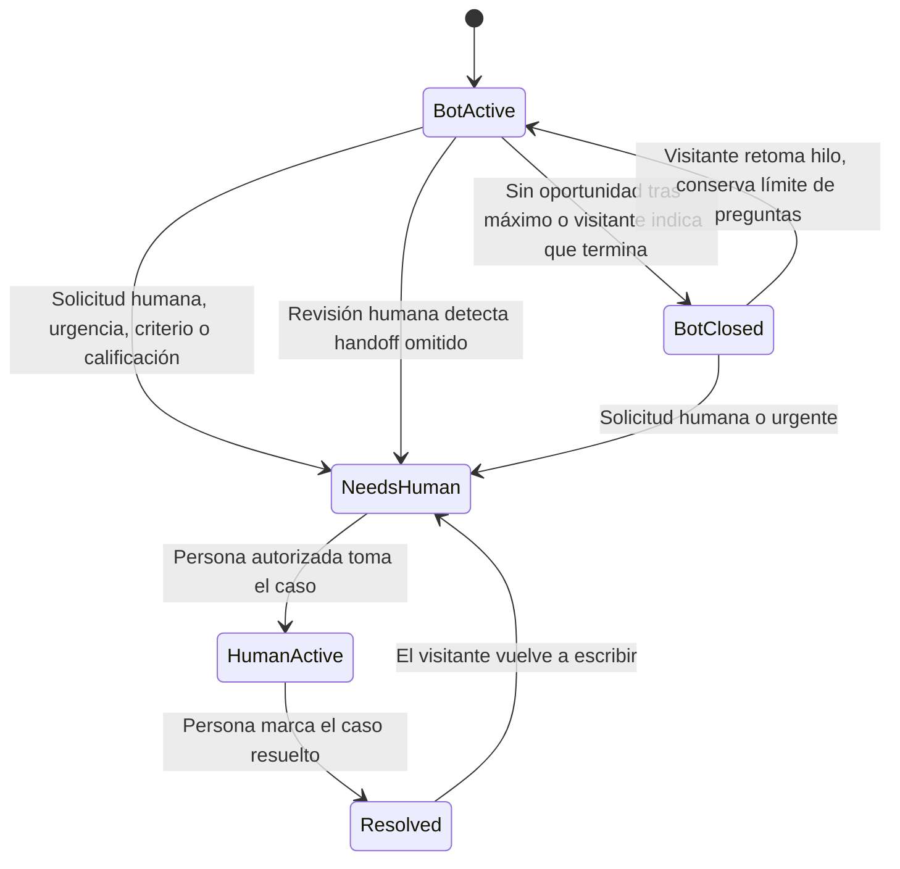
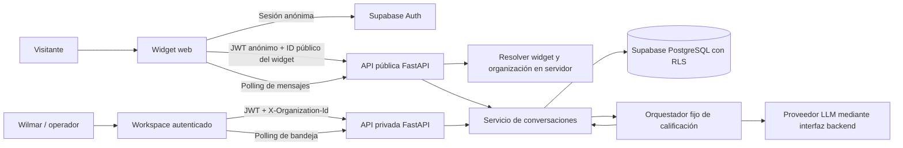
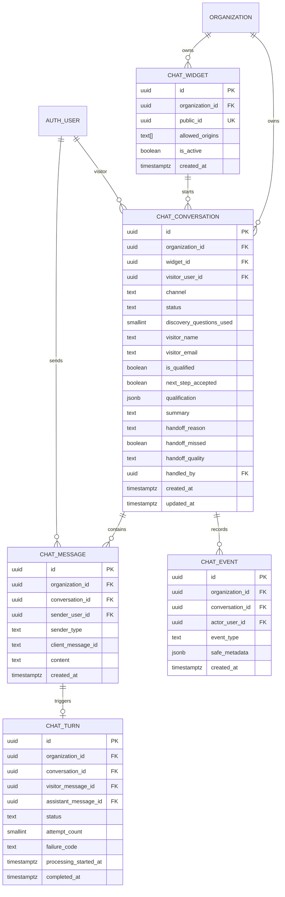

# Plan de implementación: chat web para calificar oportunidades operativas

- **Estado:** alcance de producto acordado; implementación pendiente.
- **Última actualización:** 2026-10-29
- **Propietario del piloto:** Wilmar
- **Documento relacionado:** [`ARCHITECTURE.md`](../../ARCHITECTURE.md), [`docs/MODULE_PATTERN.md`](../MODULE_PATTERN.md)

## Decisiones de producto fijadas

Quien implemente debe tratar estas decisiones como alcance aprobado, no reabrirlas
sin encontrar un impedimento técnico o de seguridad concreto:

- Primera versión solo web, para la calificación comercial de Nuteam; sin
  WhatsApp, Instagram, OpenClaw ni builder genérico.
- Máximo de cinco preguntas de descubrimiento; pedir nombre/correo no consume ese
  límite. El correo se solicita, pero se puede omitir.
- El handoff va a una bandeja autenticada y la persona responde en el mismo hilo.
  No hay avisos automáticos por correo; el seguimiento manual por correo ocurre
  fuera del producto.
- La medición termina en calificación, handoff y fallos operativos; no cubre
  reuniones, propuestas o clientes.
- Conversaciones y métricas se conservan indefinidamente en esta versión; no hay
  borrado automático. Las eliminaciones justificadas o exigidas se implementarán
  en una fase futura, fuera de este plan.
- El enlace de privacidad está en el footer de la landing, no en el widget.
- La bandeja inicial está restringida a `owner` y `admin`; el operador revisa la
  cola manualmente, sin notificación automática.

## Seguimiento del avance

Marca las tareas completadas con `[x]`. Una fase se completa cuando sus tareas y
su salida verificable están listas; las fases aún no iniciadas permanecen sin
marcar.

Quien implemente debe leer `AGENTS.md`, `ARCHITECTURE.md` y
`docs/MODULE_PATTERN.md` antes de modificar código. Ejecutar las fases en orden,
actualizar este checklist a medida que se verifiquen tareas y no marcar una tarea
como completada solo porque el código fue escrito: deben pasar sus comprobaciones.
Si aparece un conflicto de seguridad o alcance, documentar el bloqueo antes de
cambiar las decisiones fijadas.

- [ ] Fase 0 — Preparación y decisiones de despliegue
- [ ] Fase 1 — Esquema, permisos y RLS
- [ ] Fase 2 — API de conversaciones y orquestador fijo
- [ ] Fase 3 — Widget de visitante e integración de landing
- [ ] Fase 4 — Bandeja y respuesta humana
- [ ] Fase 5 — Métricas, pruebas y lanzamiento del piloto

## 1. Resumen ejecutivo

Implementar un chat web en la landing de Nuteam que converse con visitantes,
identifique oportunidades concretas para mejorar procesos operativos y deje los
casos que requieren atención humana en una bandeja interna. Una persona autorizada
podrá revisar el resumen y el historial, tomar el caso y responder dentro de la
misma conversación.

La feature prueba un proceso comercial de Nuteam con un canal real. No es todavía
el módulo genérico de discovery de procesos ni un constructor de agentes o un
motor de workflows.

El repositorio actualmente contiene el workspace multi-tenant de Next.js, FastAPI
y Supabase. `apps/web/app/page.tsx` es una pantalla de autenticación y workspace;
la landing comercial y su despliegue no aparecen en el árbol actual. La fase de
preparación debe confirmar dónde se integrará el widget y cómo compartirá la
configuración de origen y Supabase.

## 2. Problema y resultado del producto

### Trabajo que debe resolver

Ayudar a una persona interesada a explicar un problema operativo real con contexto
suficiente para que Nuteam evalúe si existe una oportunidad y acuerde un siguiente
paso comercial calificado. El resultado inicial termina cuando el caso queda
calificado y, si corresponde, visible para atención humana.

Una oportunidad calificada contiene, como mínimo:

- Un problema operativo concreto.
- Contexto del proceso actual o de cómo se realiza el trabajo.
- Una señal de volumen o impacto; se distingue si es un dato informado o una
  estimación.
- Un motivo de escalamiento y el siguiente paso que la persona solicita o acepta,
  cuando corresponda.

Para que el agente y las métricas usen el mismo criterio, marcar una conversación
como **calificada** solo cuando concurran estos elementos:

1. Problema operativo concreto.
2. Contexto del proceso actual.
3. Al menos una señal de volumen o impacto, registrada como hecho o estimación.
4. La persona acepta un siguiente paso concreto: que el equipo revise el caso y
   continúe la conversación por este chat. Esta pregunta de siguiente paso no
   cuenta como pregunta de descubrimiento y no significa una reunión reservada.

Una solicitud explícita de ayuda humana, una cotización urgente o un caso que
requiere criterio puede escalarse sin cumplir todos los criterios de calificación;
se registra como handoff no calificado con su motivo. Así se separa la métrica de
oportunidad calificada del volumen total de escalamientos.

La cantidad de mensajes o de preguntas contestadas no es una medida de éxito.
Reuniones realizadas, propuestas y clientes quedan fuera de la medición de esta
versión porque ocurren después del handoff y dependen del seguimiento comercial.

### Métricas semanales del piloto

La bandeja debe permitir revisar por semana:

1. Conversaciones comerciales únicas recibidas, contadas por ID de conversación
   creado durante la semana; no se deduplican personas entre sesiones.
2. Oportunidades calificadas según el criterio anterior.
3. Conversaciones que requieren o reciben handoff humano.
4. Calidad del handoff: útil o prematuro, marcada por la persona que revisa el
   caso.
5. Fallos operativos: mensajes duplicados, errores de persistencia o generación,
   y casos urgentes identificados en revisión que no se escalaron.

No se registrarán métricas de reuniones, propuestas o clientes ganados en esta
feature.

## 3. Alcance

### Incluido en la primera versión

- Widget de chat web en la landing de Nuteam que sustituye el CTA principal de
  WhatsApp una vez superadas las comprobaciones de lanzamiento.
- Identidad inicial del visitante mediante sesión anónima de Supabase Auth; nombre
  y correo se preguntan en la conversación. Si no desea compartir el correo, podrá
  continuar, pero se le explicará que no habrá seguimiento fuera del chat.
- Conversación guiada con IA, limitada a este caso comercial y con un máximo de
  cinco preguntas de descubrimiento. Las preguntas iniciales de nombre y correo
  no cuentan para ese límite.
- Persistencia del historial y reanudación de la conversación en el mismo
  navegador mientras se conserve su sesión.
- Resolución de la organización del widget en el servidor, sin aceptar un
  `organization_id` enviado por el visitante como autoridad.
- Bandeja interna tenant-scoped con casos pendientes, resumen, historial,
  asignación/toma por una persona, respuesta manual en el chat y cierre del caso.
- Suspensión del agente cuando se solicita atención humana o una persona toma el
  caso.
- Métricas operativas semanales hasta el handoff.
- Aviso de privacidad en el footer de la landing, que incluya expresamente este
  chat, el procesamiento mediante IA, los datos recopilados y el seguimiento
  humano.
- Conservación indefinida de conversaciones y métricas: sin borrado automático ni
  plazo de vencimiento en esta versión.

### Fuera del alcance

- Conectores o recepción por WhatsApp, Instagram u otros canales.
- Reutilizar o integrar el agente de OpenClaw.
- Constructor genérico de agentes, editor de workflows o motor durable de
  workflows.
- CRM, Google Sheets, calendario, reserva automática, pagos o registro de leads en
  sistemas externos.
- Avisos automáticos por correo, tanto a Wilmar como al visitante.
- Seguimiento comercial posterior al handoff desde la aplicación. Si hace falta,
  Wilmar podrá contactar manualmente al visitante por correo usando la información
  recopilada; ese intercambio ocurre fuera de la feature.
- Eliminación automática, endpoint de borrado o flujo de solicitudes de eliminación.
  La capacidad para eliminaciones justificadas o exigidas queda como trabajo futuro.
- Notificaciones push o tiempo real en la primera versión; la bandeja y el chat
  consultan cambios mediante polling.
- Panel de configuración autoservicio para clientes o un gestor genérico de
  widgets.

## 4. Experiencia y reglas conversacionales

### Flujo del visitante

1. Abre el chat desde la landing y ve el saludo, el propósito y la invitación a
   explicar su necesidad.
2. El agente se presenta, pide el nombre y luego el correo. El correo es opcional;
   si se omite, el chat continúa y explica que el seguimiento fuera de la
   conversación no será posible.
3. El agente explora el problema, el proceso actual, el volumen y el impacto,
   adaptando las preguntas a las respuestas ya recibidas.
4. Se detiene antes de cinco preguntas si ya hay suficiente contexto. No formula
   más de cinco preguntas de descubrimiento.
5. Si se cumplen problema, proceso y señal de impacto/volumen, pregunta si la
   persona acepta que el equipo revise el caso y continúe por este chat. Esa
   pregunta de siguiente paso no cuenta como descubrimiento ni como reserva de una
   reunión.
6. Si corresponde, resume el contexto y deja la conversación marcada como
   **Requiere atención**. El mensaje visible no menciona a Wilmar ni promete un
   tiempo de respuesta. Texto inicial recomendado:

   > Gracias por compartir el contexto. Tu consulta quedó marcada para revisión
   > del equipo. Si hace falta dar seguimiento, te responderemos en esta
   > conversación.

7. La persona puede volver a abrir la conversación en el mismo navegador. Si
   pierde su sesión o cambia de dispositivo, la recuperación no está incluida; el
   seguimiento manual por correo es el mecanismo operativo acordado.

Una petición explícita de hablar con una persona o una cotización urgente no debe
esperar a que termine el descubrimiento ni a que se comparta el correo: guardar la
información disponible y pasarla a `needs_human` con el motivo correspondiente.

### Política de descubrimiento y decisión

- Escalar ante una solicitud explícita de hablar con alguien, una cotización que
  el visitante identifica como urgente, un caso que requiere criterio humano o
  una oportunidad calificada. No inventar un nivel de urgencia ni un SLA.
- Considerar que requiere criterio humano una petición de recomendación o
  decisión específica que no esté respaldada por el contenido aprobado, o que el
  visitante solicite expresamente una persona.
- Cuando se cumplen problema, proceso y señal de impacto/volumen, preguntar si la
  persona acepta que el equipo revise el caso y continúe por el chat. Solo después
  de su aceptación clasificar como calificada; no ofrecer una reunión reservada.
- No escalar saludos, preguntas generales ni una pregunta aislada de precio sin
  contexto.
- No convertir estimaciones en hechos: cualquier cálculo basado en datos
  incompletos se identifica como estimación, nunca como ahorro garantizado.
- No inventar precios, ahorros, plazos, disponibilidad ni reservas. No existe una
  integración de calendario.
- Si faltan datos, el agente puede preguntar dentro del límite. Alcanzar cinco
  preguntas por sí solo no convierte una conversación en oportunidad calificada;
  si el límite se alcanza sin contexto suficiente, cerrar la exploración sin
  inventar calificación, salvo que aplique un motivo de handoff independiente.
- Usar contenido comercial aprobado de Nuteam. Si la respuesta no está respaldada,
  decirlo y ofrecer la ruta humana aplicable.
- La IA interpreta lenguaje ambiguo y redacta respuestas; reglas deterministas
  controlan el límite de preguntas, la calificación, el handoff, los permisos y
  los estados.
- Cada respuesta del agente es breve y contiene como máximo una pregunta. No
  agrupar varias preguntas en un solo mensaje.

### Estados de conversación



Al entrar en `NeedsHuman`, la IA deja de generar respuestas automáticas. En
`HumanActive`, solo la persona autorizada responde. `BotClosed` permite revisar
conversaciones sin handoff y puede reabrirse si el visitante vuelve; el contador
de preguntas no se reinicia. Una conversación resuelta por una persona vuelve a la
cola humana si el visitante escribe de nuevo; la IA no retoma un hilo atendido por
una persona.

## 5. Arquitectura objetivo de esta feature



### Límites de responsabilidad

- **Landing/widget:** renderiza el chat, recoge entradas y conserva la sesión
  anónima. No consulta tablas de negocio directamente.
- **FastAPI:** valida sesión, tenant, permisos, contratos, reglas de calificación,
  llamadas al proveedor IA, idempotencia y errores. Toda persistencia de negocio
  pasa por FastAPI.
- **Supabase Auth:** emite la identidad anónima del visitante y mantiene la
  autenticación de operadores.
- **PostgreSQL/RLS:** conserva conversaciones, mensajes, eventos y configuración
  de widgets; aplica aislamiento por organización y acceso del visitante solo a su
  propia conversación.
- **LLM:** propone una respuesta y campos estructurados. No ejecuta acciones
  externas ni determina por sí solo autorización, estado, permiso de escalamiento
  o acceso a datos.
- **Polling:** primera versión con polling acotado y backoff mientras el chat o la
  bandeja están abiertos. Supabase Realtime queda como evolución si el piloto
  demuestra que el polling no ofrece una experiencia suficiente.

El código actual de `apps/web` no es la landing comercial. Antes de decidir entre
componente compartido, script o iframe, confirmar el repositorio y dominio de esa
landing. Esa decisión afecta CORS, autenticación en navegador y persistencia de la
sesión; no asumir que las cookies de terceros estarán disponibles.

### Scaffolding de código propuesto

La estructura concreta se ajusta en la Fase 0 al confirmar dónde vive la landing.
En el repositorio actual, el módulo de negocio y el workspace de atención seguirían
estas convenciones:

```text
apps/api/app/
  api/routes/
    chat_public.py             # Rutas para visitante con JWT anónimo
    chat_operator.py           # Bandeja y respuestas con JWT de usuario
  schemas/
    chat.py                    # Contratos Pydantic de request/response
  services/chat/
    conversations.py           # Casos de uso y transiciones de estado
    qualification.py           # Reglas deterministas y límites
    model_gateway.py           # Interfaz/adaptador del proveedor LLM
  repositories/
    chat.py                    # Consultas con cliente Supabase por request
  tests/
    unit/test_chat_qualification.py
    integration/test_chat_rls.py

apps/web/
  components/chat/
    chat-widget.tsx            # Solo si la landing puede consumir este componente
    conversation-thread.tsx
    operator-inbox.tsx
  app/                         # Ruta autenticada de atención integrada al workspace
  tests/                       # Vitest
  e2e/                         # Flujo widget -> handoff -> respuesta humana

supabase/migrations/
  <timestamp>_web_chat.sql     # Tablas, funciones, triggers, grants y RLS
```

No crear un SDK público de canales ni un editor de configuración genérico. Si la
landing vive en otro repositorio, el componente público se implementa allí o se
integra mediante el mecanismo elegido en la Fase 0; los contratos y la autoridad
de negocio permanecen en FastAPI.

### Identidad y acceso público: decisión recomendada

Usar **Supabase Auth anónimo** como identidad del visitante para que el backend
pueda aplicar el patrón existente de JWT por request y RLS, en vez de añadir una
credencial `service_role` a las rutas normales de chat.

- El widget puede usar Supabase directamente solo para `signInAnonymously`; las
  operaciones de conversación siguen pasando por FastAPI.
- Las rutas públicas validan que el JWT corresponda a una identidad anónima y no
  requieren membresía organizacional. Las rutas de operador siguen requiriendo JWT,
  organización activa y permiso.
- La organización se resuelve con el identificador público del widget contra un
  registro persistido. El navegador nunca decide el tenant enviando un
  `organization_id`.
- El origen permitido del widget es una defensa adicional y una regla de
  configuración; no sustituye a la identidad ni se trata como autenticación.
- RLS permite al visitante consultar y escribir únicamente en su conversación y
  limita los datos del widget que puede conocer. Operadores acceden únicamente a
  conversaciones de organizaciones donde tienen membresía activa y permiso.
- Añadir tests con usuarios anónimos y JWT de dos organizaciones antes de habilitar
  la ruta en producción.

La migración actual crea un perfil con `email NOT NULL` para cada usuario Auth. La
implementación de Auth anónimo debe adaptar el trigger de perfiles para omitir los
usuarios anónimos (o aplicar una solución equivalente validada), ya que estos no
tienen por qué tener correo. No crear perfiles ficticios ni confiar en el nombre o
correo introducidos en el chat como identidad autenticada.

La cuenta Auth anónima y la conversación se conservarán mientras no exista la
capacidad futura de eliminación. Este efecto debe considerarse en el aviso de
privacidad y en la revisión de configuración de Supabase.

## 6. Modelo de dominio propuesto

El modelo es conceptual; los nombres finales se fijan al diseñar la migración.
Todas las entidades de negocio incluyen `organization_id NOT NULL`, índices y
claves foráneas tenant-scoped conforme a `docs/MODULE_PATTERN.md`.



### Reglas del modelo

- `organization_id` es inmutable. Las claves foráneas entre widget,
  conversación, mensaje y evento incluyen la organización.
- `channel` puede representarse desde el inicio como `web`, pero no se implementan
  conectores de otros canales. La lógica de conversación no depende de la forma en
  que el widget entrega los mensajes.
- `qualification` contiene datos estructurados y separación entre hechos y
  estimaciones; no usar un JSON libre como sustituto de reglas o permisos.
- `is_qualified` solo se establece cuando se cumplen los cuatro criterios de
  calificación. Los casos urgentes o pedidos explícitos pueden pasar a
  `needs_human` con `is_qualified = false`.
- `status` usa un conjunto cerrado: `bot_active`, `bot_closed`, `needs_human`,
  `human_active` y `resolved`; transiciones permitidas se validan en el servicio y
  la base de datos.
- `handoff_missed` se establece durante revisión humana de una conversación no
  escalada que sí debió llegar a la bandeja; genera un evento `handoff_missed` y
  transiciona el caso a `needs_human`.
- `handoff_quality` admite `useful`, `premature` o `null` hasta que una persona
  clasifique el caso.
- Eventos de negocio registran creación, calificación, solicitud de handoff,
  toma humana, respuesta humana, resolución, calidad del handoff y fallos. No
  almacenar texto de conversación en metadatos de eventos ni logs técnicos.
- Los errores ocurridos cuando Supabase no permite persistir no pueden depender de
  una fila de evento en la misma base; contabilizarlos con telemetría técnica
  sanitizada (sin PII ni IDs de visitante). Los casos urgentes no escalados se
  identifican mediante revisión humana de conversaciones no escaladas.
- `client_message_id` es único dentro de la conversación. Reintentar una petición
  no duplica mensajes ni genera dos respuestas del agente.
- Cada mensaje de visitante que requiere IA tiene un único `chat_turn` por
  `visitor_message_id`, con estados `pending`, `processing`, `completed` o `failed`.
  Una respuesta completada queda vinculada por `assistant_message_id`. Un request
  concurrente no crea una segunda generación; un turno fallido puede reintentarse
  con el mismo mensaje. Si el proceso cae en `processing`, el siguiente reintento
  puede recuperarlo cuando venza su lease; no hay worker de recuperación en
  background.
- La tabla de mensajes guarda el autor como visitante, agente o persona. Respuestas
  humanas incluyen el `auth.uid()` del operador.
- No agregar TTL ni job de purga en esta versión. La conservación indefinida se
  aplica a mensajes, datos de contacto, sesiones anónimas, eventos y métricas.

## 7. Contratos de API propuestos

Los nombres son una propuesta de diseño; la OpenAPI final será fuente de verdad.

### API pública del widget

- `POST /api/v1/public/chat/widgets/{public_widget_id}/conversations`: crea o
  inicializa una conversación del visitante autenticado anónimamente y resuelve el
  tenant desde el widget.
- `GET /api/v1/public/chat/conversations/{id}/messages?after=...`: consulta el
  historial propio y mensajes nuevos.
- `POST /api/v1/public/chat/conversations/{id}/messages`: persiste un mensaje,
  ejecuta el turno IA de forma síncrona y devuelve la respuesta persistida. Si
  ocurre un timeout/fallo, devuelve un error recuperable; el cliente reintenta con
  el mismo `client_message_id`. No responde `202` ni depende de un worker.
- Todas las rutas requieren JWT anónimo válido y comprueban
  `visitor_user_id == auth.uid()`; un UUID de conversación por sí solo no autoriza
  acceso.
- Los requests públicos no aceptan `organization_id`, `status`, identidad de
  operador ni rol elegidos por el navegador.
- Validar tamaño del mensaje, frecuencia por IP/widget/usuario, estado de la
  conversación, origen permitido y límites de body.

### API privada de la bandeja

- `POST /api/v1/chat/widgets`: provisión autenticada del widget inicial; solo
  `owner`/`admin`, sin pantalla de autoservicio. El servidor genera `public_id` y
  guarda tenant y orígenes autorizados.
- `GET /api/v1/chat/conversations?status=needs_human`: lista la cola de la
  organización activa.
- `GET /api/v1/chat/conversations?handoff=none&updated_before=...`: permite la
  revisión semanal de conversaciones bot activas/cerradas sin handoff. El valor
  inicial de `updated_before` es ahora menos 24 horas para no interrumpir hilos
  activos; no incluir conversaciones con actividad más reciente.
- `GET /api/v1/chat/conversations/{id}`: carga resumen, datos estructurados e
  historial autorizado.
- `POST /api/v1/chat/conversations/{id}/take`: asigna el caso al operador y
  transiciona a `human_active`.
- `POST /api/v1/chat/conversations/{id}/messages`: añade una respuesta humana al
  hilo.
- `POST /api/v1/chat/conversations/{id}/resolve`: marca el caso resuelto.
- `PATCH /api/v1/chat/conversations/{id}/handoff-quality`: registra si el handoff
  fue útil o prematuro.
- `POST /api/v1/chat/conversations/{id}/review-missed-handoff`: marca que la
  revisión humana detectó una omisión, registra `handoff_missed` y mueve el caso a
  `needs_human`.
- `GET /api/v1/chat/metrics?from=...&to=...`: devuelve agregados por semana para
  la organización.
- Cada endpoint exige JWT de usuario, `X-Organization-Id`, membresía activa y
  permiso declarado en `ROLE_PERMISSIONS`. La UI no autoriza por sí sola.

### Permisos

Añadir permisos explícitos, por ejemplo `chat:read` y `chat:manage`, a
`ROLE_PERMISSIONS`. En la primera versión solo `owner` y `admin` administran la
bandeja y responden. Si Wilmar opera como `member`, revisar el rol asignado o
definir explícitamente la política antes de abrir acceso; no introducir roles
configurables.

`POST /api/v1/chat/widgets` provisiona el widget del piloto mediante una operación
protegida de owner/admin. No se necesita una pantalla de configuración para
crearlo; una vez provisionado, el identificador público se configura en la
landing.

## 8. Comportamiento del agente y fallos

### Implementación acotada

- Crear un servicio de dominio para el flujo de calificación y un adaptador de
  modelo en FastAPI. No construir un framework genérico de agentes ni exponer
  prompts como una configuración arbitraria del usuario.
- Mantener en código/configuración versionada las instrucciones, el esquema de
  salida y el contenido comercial aprobado del piloto.
- Validar la salida estructurada con Pydantic. La lógica determinista valida el
  número de preguntas, estado, contexto mínimo y razón de handoff.
- El proveedor y modelo deben configurarse en backend; las credenciales nunca
  llegan a Next.js ni a logs. Elegir proveedor antes de implementar el adaptador y
  comprobar sus condiciones de tratamiento de datos.
- No almacenar razonamiento interno del modelo. Persistir mensajes visibles,
  hechos/estimaciones y decisiones operativas necesarias para la trazabilidad.
- Primera versión síncrona por turno, con timeout acotado, clave de idempotencia,
  control de generación concurrente y estado de fallo recuperable. No seleccionar
  una cola ni un motor durable para este piloto.

### Comportamiento ante errores

- Si el proveedor IA no responde, guardar el mensaje recibido y mostrar un error
  recuperable; no inventar una respuesta ni afirmar que se notificó a una persona.
- El reintento conserva el mismo identificador idempotente y no duplica el mensaje
  ni crea dos respuestas.
- Si falla persistencia, no confirmar al visitante que su mensaje quedó guardado.
- Si la sesión expiró, pedir que se restaure la sesión anónima cuando sea posible;
  no aceptar un UUID como sustituto de autenticación.
- Una solicitud urgente o explícita de atención humana debe persistir su motivo y
  entrar a `needs_human`, incluso si el modelo no está disponible cuando la regla
  puede evaluarse de forma determinista.
- La bandeja presenta errores de lectura/escritura y ofrece reintento. La
  indisponibilidad no debe marcar silenciosamente el caso como resuelto.

## 9. Seguridad, privacidad y operación

### Aislamiento y autenticación

- Todas las tablas de conversación, widget, mensaje y evento tienen RLS activo,
  `organization_id NOT NULL`, índices y políticas separadas por operación.
- Las operaciones de usuario/operador usan un cliente Supabase por request con el
  JWT del usuario. No usar `service_role` como cliente normal de la API.
- Las policies de visitante anónimo limitan lectura/escritura al `visitor_user_id`
  autenticado y a conversaciones del widget activo. Las policies de staff
  requieren membresía y permiso organizacional.
- Añadir claves foráneas compuestas tenant-scoped, validación de estados en el
  backend y protección contra cambios de `organization_id`.
- Registrar en auditoría las acciones internas sensibles: tomar, responder,
  resolver y clasificar calidad del handoff.

### Datos y logs

- Recopilar nombre, correo, mensajes y contexto operativo necesario. El correo se
  solicita, pero no se impide continuar si el visitante decide no compartirlo.
- Indicar en el aviso del footer que el chat usa IA y que la información puede
  usarse para responder en el mismo hilo o para seguimiento humano manual.
- No pedir credenciales, datos de pago ni información sensible innecesaria. La
  guía del agente debe invitar a resumir procesos sin compartir secretos de
  sistemas o de clientes.
- Mensajes y PII no se escriben en logs, eventos de error, métricas Prometheus ni
  analítica externa. Sanitizar errores del proveedor IA.
- La telemetría técnica usa etiquetas de baja cardinalidad (ruta, resultado,
  código de fallo), nunca email, contenido, UUID de conversación ni JWT.
- Enviar al modelo solo el contexto necesario. Revisar antes del lanzamiento que
  el proveedor elegido y su configuración sean compatibles con el aviso de
  privacidad; no afirmar que los datos no se usan para entrenamiento sin verificar
  las condiciones del servicio.
- Conservación indefinida acordada para esta versión. No agregar borrado
  automático, TTL, ni una función de eliminación en este plan. Las eliminaciones
  justificadas o exigidas serán una iniciativa posterior.
- La revisión del texto del aviso en el footer para el mercado de operación es una
  condición de lanzamiento; su enlace vive en el footer de la landing, no dentro
  del widget.

### Abuso y disponibilidad

- Aplicar el rate limiter Redis existente a las rutas públicas y añadir cuotas
  específicas por widget, sesión anónima y creación de mensajes.
- El rate limiter actual se basa en `request.client.host`; seguir
  `docs/OPERATIONS.md` para confiar en proxies y no aceptar `X-Forwarded-For`
  enviado por el navegador.
- `Origin` y lista de dominios permitidos son controles complementarios, no una
  identidad secreta. La seguridad de lectura se basa en JWT y RLS.
- Configurar límites de Auth anónimo y protección contra abuso de acuerdo con
  Supabase. Evaluar CAPTCHA solo si la tasa real de abuso lo requiere.
- Configurar orígenes CORS explícitos para la landing y el workspace en cada
  entorno; staging/producción siguen requiriendo Redis y secretos de producción.
- No enviar notificaciones automáticas. La bandeja se actualiza por polling; la
  operación inicial asume que Wilmar revisará los casos pendientes.

## 10. Fases de implementación

### Fase 0 — Preparación y decisiones de despliegue

**Trabajo**

- [ ] Localizar el repositorio, hosting, dominio y footer de la landing comercial.
- [ ] Confirmar la organización de Nuteam que será propietaria del widget en cada
  entorno y cómo se creará el primer registro de widget con permisos de owner.
- [ ] Verificar Supabase Auth anónimo local y administrado, límites, persistencia del
  JWT y el trigger actual de perfiles.
- [ ] Seleccionar proveedor/modelo LLM, timeout, límites de costo y política de datos.
- [ ] Recopilar FAQ/capacidades aprobadas, ejemplos de conversaciones y casos
  positivos/negativos de handoff.
- [ ] Aprobar el copy para acordar el siguiente paso y el cierre cuando se agoten
  las cinco preguntas sin calificación.
- [ ] Escribir el aviso de privacidad del footer para incluir el tratamiento real.
- [ ] Decidir si widget y landing compartirán origen o si requieren integración
  cross-origin; probar persistencia de Auth en ese contexto antes de fijar el
  mecanismo de embed.

**Salida:** contrato de integración, configuración por entorno, contenido base y
decisión de proveedor listos antes de construir el chat.

### Fase 1 — Esquema, permisos y RLS

**Trabajo**

- [ ] Añadir una migración incremental para widgets, conversaciones, mensajes,
  turnos IA y eventos; incluir índices, enums/constraints, claves compuestas y
  políticas RLS.
- [ ] Adaptar el trigger de perfiles para identidades anónimas sin correo.
- [ ] Añadir permisos de bandeja a `ROLE_PERMISSIONS` y proteger acceso por rol,
  organización y operación.
- [ ] Añadir la operación autenticada owner/admin para provisionar el widget del
  piloto sin crear un editor de widgets autoservicio.
- [ ] Crear resolución server-side de widget público y políticas que impidan que el
  visitante escoja su tenant o lea conversaciones ajenas.
- [ ] Especificar el estado/turno idempotente para que un retry de mensaje no produzca
  duplicados ni dos respuestas IA.

**Salida:** migración aplicable incrementalmente; tests RLS de usuario anónimo y
dos organizaciones; ningún endpoint usa `service_role` como acceso normal.

### Fase 2 — API de conversaciones y orquestador fijo

**Trabajo**

- [ ] Crear schemas Pydantic y servicios de dominio separados para visitante,
  operación humana y calificación IA.
- [ ] Implementar resolución del widget, creación de conversación, lectura de hilo,
  recepción de mensaje y validación de sesión/estado.
- [ ] Añadir el adaptador del proveedor de modelo y el flujo guiado de un mensaje a la
  vez, con máximo cinco preguntas de descubrimiento.
- [ ] Procesar cada turno IA síncronamente con timeout; mantener el mensaje del
  visitante y el resultado idempotentes para permitir reintentos seguros.
- [ ] Codificar de forma determinista los criterios de calificación, handoff,
  estimación, no-promesas y suspensión de IA.
- [ ] Añadir idempotencia, rate limits, errores recuperables y eventos operativos
  sanitizados.

**Salida:** API pública documentada en OpenAPI, contract tests y tests unitarios
del flujo conversacional con el proveedor simulado.

### Fase 3 — Widget de visitante e integración de landing

**Trabajo**

- [ ] Construir UI accesible de chat: iniciar, nombre/correo, mensajes, indicador de
  envío, error/reintento y estado de revisión humana.
- [ ] Reutilizar la sesión anónima para reabrir el hilo desde el mismo navegador.
- [ ] Implementar polling con backoff y cursores; no añadir Realtime todavía.
- [ ] Integrar en la landing y sustituir el CTA de WhatsApp tras completar staging.
- [ ] Confirmar footer de privacidad, copy de handoff y dominios CORS.

**Salida:** recorrido completo de visitante probado en navegador desde landing a
respuesta IA y handoff persistido.

### Fase 4 — Bandeja y respuesta humana

**Trabajo**

- [ ] Añadir una vista autenticada por organización con filtros básicos y cola
  `needs_human`.
- [ ] Mostrar resumen, contexto estructurado, indicador hecho/estimación e historial
  ordenado.
- [ ] Incluir una lista filtrable de conversaciones sin handoff e inactivas para
  revisión semanal; permitir marcar una omisión y pasarla a la cola humana.
- [ ] Permitir tomar el caso, responder dentro del hilo, resolver y clasificar el
  handoff como útil o prematuro.
- [ ] Desactivar respuestas IA durante y después de la atención humana.
- [ ] Actualizar cola y conversación mediante polling; no enviar correo ni push.

**Salida:** operador puede encontrar, entender, responder y cerrar un caso sin
salir del workspace.

### Fase 5 — Métricas, pruebas y lanzamiento del piloto

**Trabajo**

- [ ] Mostrar métricas semanales acordadas con filtros por periodo y organización.
- [ ] Añadir revisión de conversaciones no escaladas para identificar casos urgentes
  omitidos y registrar ese fallo.
- [ ] Completar pruebas unitarias, integración RLS multi-tenant y E2E de los dos
  recorridos principales.
- [ ] Probar errores de Auth, Supabase, Redis y modelo; verificar rate limits, no
  duplicación y persistencia tras recargar.
- [ ] Publicar primero en staging, observar el uso y después reemplazar el CTA de
  WhatsApp en producción.

**Salida:** criterios de aceptación completos, métricas iniciales visibles y
procedimiento operativo para revisar pendientes.

## 11. Criterios de aceptación

### Conversación y agente

- Nombre y correo se solicitan al inicio, uno por vez; no compartir el correo no
  bloquea continuar y se comunica la limitación de seguimiento externo.
- Se hacen como máximo cinco preguntas de descubrimiento, se puede detener antes
  cuando el contexto es suficiente y no se confunden preguntas de contacto con el
  límite.
- Cada mensaje del agente es breve y contiene como máximo una pregunta.
- Solo se marca `is_qualified = true` cuando existen problema concreto, contexto
  del proceso, señal de volumen/impacto y aceptación del siguiente paso por chat.
- Un pedido explícito de persona, una cotización urgente o criterio humano puede
  generar `needs_human` con `is_qualified = false`.
- Llegar al límite sin reunir los criterios no califica el caso y no provoca una
  sexta pregunta de descubrimiento.
- Un saludo o pregunta de precio aislada no crea handoff.
- Una conversación no escalada e inactiva se puede revisar por antigüedad; si el
  operador detecta una urgencia que no se escaló, al marcarla como omisión entra a
  `needs_human` y cuenta una sola vez.
- El resumen identifica el problema, el proceso, volumen/impacto y si cada dato es
  hecho o estimación.
- El agente no promete precio, ahorros garantizados, plazos ni reservas.
- Tras el handoff, el agente no vuelve a contestar ese hilo; la persona responde
  dentro de la misma conversación.

### Seguridad y datos

- El visitante no puede acceder a una conversación usando solo su UUID ni leer
  otro hilo/tenant.
- La organización del visitante procede del widget configurado en servidor, nunca
  de un `organization_id` arbitrario del request.
- Un operador sin membresía/permiso no puede listar, leer, responder o cerrar
  conversaciones del tenant.
- Las pruebas con JWT reales de dos organizaciones verifican RLS para lectura y
  escritura, también con usuarios anónimos.
- Repetir una petición con el mismo `client_message_id` no duplica mensajes ni
  respuestas. Requests concurrentes o retries de un turno fallido no crean más de
  una respuesta IA visible para el mismo mensaje de visitante.
- No se filtran tokens, PII ni cuerpos de conversación a logs o métricas técnicas.
- Los datos permanecen tras reiniciar/reconectar; no hay expiración ni borrado
  automático.

### Operación

- La bandeja permite revisar casos pendientes sin depender de correo automático.
- El visitante ve estados precisos; la interfaz no promete que el caso se haya
  leído ni que habrá respuesta en un plazo específico.
- Los contadores semanales coinciden con eventos de prueba y no incluyen
  reuniones, propuestas o clientes.
- El recuento de conversaciones no escaladas usa un periodo de inactividad y no
  interrumpe hilos que todavía estén activos.
- La documentación de privacidad del footer cubre el uso del chat y los
  proveedores realmente desplegados.

## 12. Estrategia de pruebas y verificación

- **Unitarias API:** límite de preguntas, normalización/validación de salida IA,
  criterios de calificación, estados, motivos de handoff, resumen y fallos.
- **Integración API/RLS:** JWT de operadores de dos organizaciones, JWT anónimo,
  acceso propio/ajeno, widget de otro tenant, permisos, inserciones cruzadas,
  concurrencia e idempotencia; verificar que Auth anónimo sin email no falle ni
  genere un perfil inválido.
- **Vitest:** componentes de chat y bandeja, polling, reintentos, estados vacíos,
  permisos y errores con API simulada.
- **Playwright:** visitante inicia y califica; otro recorrido escala, operador toma,
  responde y el visitante ve la respuesta en el mismo hilo.
- **Operación:** rate limit con Redis real, Supabase local, caída del proveedor IA,
  recarga/cierre y reapertura en el mismo navegador, y CORS del dominio real.

Comandos del repositorio cuando se implemente:

```bash
pnpm test:api
pnpm test:api:integration
pnpm test:web --coverage
pnpm lint:api
pnpm lint:web
pnpm --dir apps/web build
pnpm test:e2e
```

Las suites de integración y E2E requieren Supabase local conforme al `README.md`;
no ejecutar pruebas destructivas contra datos de producción.

## 13. Riesgos y decisiones que deben cerrarse al iniciar implementación

| Riesgo/decisión | Tratamiento en el plan |
| --- | --- |
| La landing no está en `apps/web` | Localizar repositorio y dominio en Fase 0; decidir modalidad de embed después de verificar Auth y CORS. |
| Auth anónimo no está habilitado ni probado en este starter | Probarlo local/staging, configurar límites y adaptar trigger de perfiles antes de habilitar el widget. |
| El proveedor LLM no está escogido | Elegir proveedor y revisar tratamiento de datos, coste y timeouts en Fase 0; secreto solo en API. |
| Sesiones de chat persistentes son credenciales del visitante | Usar JWT anónimo verificado por FastAPI y RLS; no tratar UUID o email como secreto. |
| No habrá alertas automáticas para Wilmar | La primera versión requiere revisar una bandeja autenticada; evaluar alertas solo con evidencia de uso. |
| El visitante puede cerrar el navegador | La sesión anónima permite volver en el mismo navegador; no se incluye recuperación por email ni dispositivo distinto. Seguimiento manual queda fuera de la app. |
| Retención indefinida | No purgar automáticamente; informar en footer y revisar el aviso para los mercados de operación. El borrado justificado se planifica en una fase futura. |
| IA o red fuera de servicio | Persistir de forma idempotente, mostrar un error recuperable, registrar código de fallo sin PII y no afirmar que hubo handoff si no ocurrió. |

## 14. Resultado esperado de esta planificación

Este documento define el alcance y el orden de ejecución, no afirma que la feature
ya exista. El primer trabajo de implementación debe comenzar por la Fase 0 y por
una revisión de seguridad del mecanismo de sesión anónima y RLS. No se debe iniciar
con un constructor genérico de agentes, conectores de canales o selección de un
motor durable de workflows.
